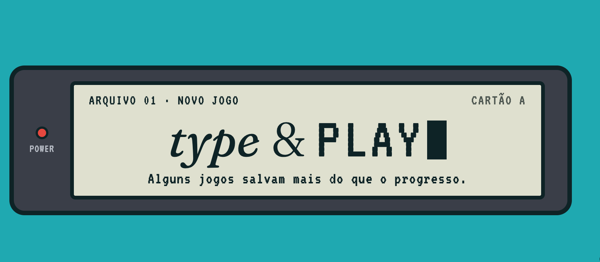

Cada texto mora numa pasta dentro de `src/content/posts/`. O nome da pasta vira o endereço: esta pasta se chama `how-to-write`, então o texto abre em `typeandplay.pages.dev/blog/how-to-write/`. Use letras minúsculas e hífens no nome da pasta, sem acentos.

## O cabeçalho

Entre os dois `---` do começo do arquivo ficam os dados do texto:

- `title`: o título.
- `description`: uma frase que aparece na lista de textos e quando alguém compartilha o link.
- `date`: a data, no formato ano-mês-dia.
- `cover` e `coverAlt`: a imagem de capa e a descrição dela, para quem usa leitor de tela. A capa é sempre **1600×700 px** e ocupa a largura inteira da janela. As duas são opcionais.
- `game`, `platform` e `year`: o jogo de que o texto fala. Aparecem juntos numa etiqueta de cartucho. Opcionais.
- `draft: true`: guarda o texto como rascunho. Ele aparece no `npm run dev`, mas não vai para o site. Apague a linha quando for publicar.

## Imagens

Coloque a imagem na mesma pasta do texto e chame assim:

O site gera versões menores sozinho, então pode usar a foto original.

Para apontar para outro texto do blog, use o caminho a partir desta pasta: `[o outro texto](../outro-texto/)`.

## Citações e pausas

> Uma citação aparece dentro de uma tela, como esta.

Uma linha só com três hífens separa partes do texto:

---

**Negrito** e *itálico* funcionam como em qualquer Markdown.

## Vídeos do canal

Para pôr um vídeo do YouTube no meio do texto, troque a extensão do arquivo de `.md` para `.mdx` e escreva `<YouTube id="código-do-vídeo" />` numa linha. O código é o que vem depois de `watch?v=` no link do vídeo.

## Publicar

Salve, faça commit e push para a branch `main`. O Cloudflare monta o site e publica em uns dois minutos.
